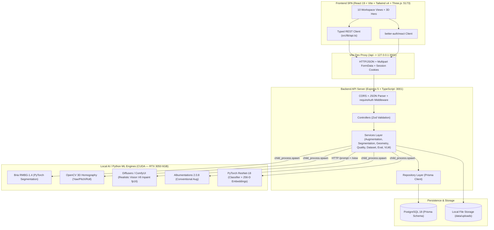
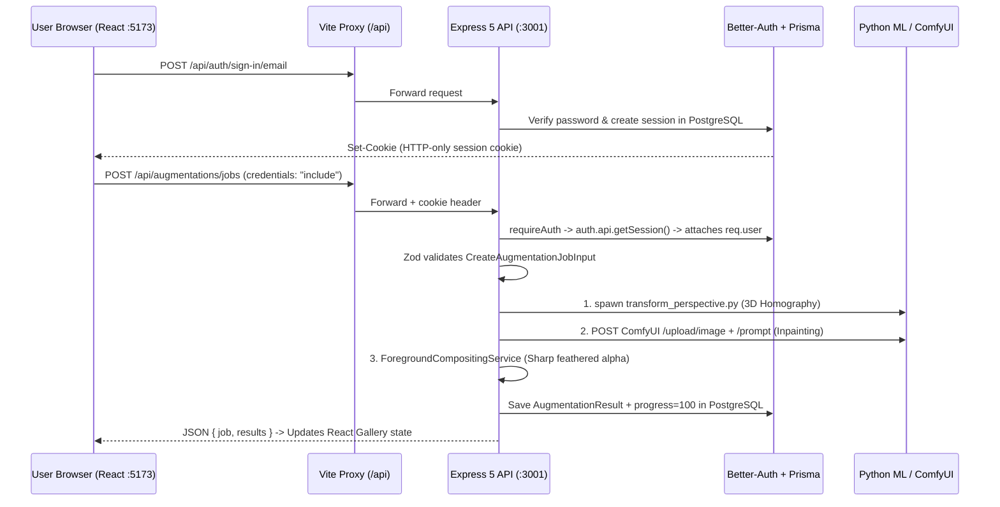

# CatalogAugment AI — Complete End-to-End Study Guide

**Project Title:** CatalogAugment AI: Product Image Augmentation Pipeline  
**Domain / Industry:** Retail & E-Commerce  
**Team Members:** `aniket_mahto`, `gauravgautam_madan`, `ansh_shukla`, `Alok Raj`  
**Repository:** `github.com/applejuice093/CatalogAugment-AI-Product-Image-Augmentation-Pipeline`

---

## 1. Problem Statement & How We Solve It

### The Core Problem
E-commerce visual-search and product-recommendation models are trained almost exclusively on **pristine studio catalog photography** (pure white backgrounds, bright even lighting, flat 90° frontal poses, zero noise). In our Week 1 photometric audit, the studio catalog had a mean brightness of **0.868** (near pure white).

When real shoppers upload smartphone photos from home, stores, or outdoors, those images suffer from five simultaneous shifts:
1. **Cluttered, textured backgrounds** (wood tables, plaid fabrics, bedroom closets, concrete streets)
2. **Camera angles & viewpoints** (3/4 oblique views, top-down flat-lays, low-angle rack shots, tilted handheld snaps)
3. **Uneven lighting & color casts** (dim tungsten rooms, fluorescent tints, directional shadows)
4. **Camera optical degradation** (motion blur, low-light ISO grain, WhatsApp/social-media JPEG compression)
5. **Partial occlusion & scale shifts** (hands, tags, off-center cropping)

Because of this **train-to-test domain gap**, our unaugmented baseline `ResNet-18` model scored **97.2% on clean studio photos**, yet collapsed to **38.9% classification accuracy** and **36.1% visual-search Recall@1** on realistic customer smartphone photos — frequently confusing textured backgrounds (plaid/wood/tile) for patterned shirts.

### Our Solution
**CatalogAugment AI** is a **hybrid conventional + controlled generative data augmentation pipeline** paired with a **full-stack interactive web studio** and a **PyTorch robustness benchmarking suite**:
1. **Conventional Augmentation (`Albumentations`)** teaches invariance to camera tilt, scale, dim/cast lighting, blur, ISO noise, JPEG artifacts, and mild occlusion at near-zero compute cost.
2. **Controlled Generative Augmentation (`Bria RMBG-1.4` + 3D Homography + Hugging Face `Diffusers` / `ComfyUI` + Feathered Foreground Compositing)** replaces studio white backgrounds with diverse 3D real-world environments and genuine camera angles while **mathematically locking product identity** (`r = 0.9912` foreground correlation vs. `0.027` for uncontrolled diffusion).
3. **Automated Quality Gating** filters out hallucinations, edge artifacts, or exposure failures before images ever enter a training dataset.
4. **PyTorch Integration & 5-Condition Stress Testing** proves quantitative visual-search and classification gains on strictly held-out unseen products (**+44.4 pts** on hard customer photos, **100.0%** on unseen background clutter, **93.1%** average real-world visual-search Recall@1).

---

## 2. Complete System Architecture

---

## 3. Phase-by-Phase Project Walkthrough (Start to End)

### Phase 0 — Environment, Hardware Budget & Database Foundation
* **Hardware Target:** Local laptop with **NVIDIA GeForce RTX 3050 (6 GB VRAM)** and **16 GB system RAM** on Windows. Every model and batching decision was engineered around this strict 6 GB VRAM envelope.
* **Database Setup:** Configured **PostgreSQL 18** (`localhost:5432`) and pushed the **Prisma 6** schema (`prisma/schema.prisma`) defining all 11 relational tables.
* **Model Provisioning:**
  * Generative Inpainting: `Realistic_Vision_V6.0_NV_B1_inpainting_fp16.safetensors` (2.13 GB, fp16) from Hugging Face (`SG161222/Realistic_Vision_V6.0_B1_noVAE`).
  * Neural Segmentation: `briaai/RMBG-1.4` (176 MB safetensors).
* **Python ML Stack Installed:** `torch 2.14.0+cu130`, `torchvision`, `albumentations 2.0.8`, `diffusers 0.43.0`, `accelerate`, `transformers`, `safetensors`, `opencv-python 5.0.0`, `scikit-learn 1.9.1`, `pandas 3.1.1`, `matplotlib`, `datasets`.

---

### Phase 1 (Week 1) — Product Dataset Preparation & Baseline EDA
* **Script:** [01_dataset_preparation.py](file:///C:/A/PROJECT/CatalogAugment-AI-Product-Image-Augmentation-Pipeline/ml_pipeline/01_dataset_preparation.py)
* **Input:** Hugging Face retail studio catalog stream (`benitomartin/fashion-product-images-small-384x512`, raw `384×512` RGB studio shots + taxonomy metadata).
* **Step-by-Step Processing:**
  1. Streamed and scanned 2,398 rows to collect **40 verified clean studio images per category** across **6 balanced retail categories** (`Shirts`, `Casual Shoes`, `Watches`, `Backpacks`, `Sunglasses`, `Handbags`) = **240 total images**.
  2. Ran automated hygiene checks rejecting blank (`std < 5`), sub-100px, or non-RGB images (0 corruptions passed).
  3. **Aspect-Ratio-Preserving Normalization:** Computed border-median studio canvas color, padded each `384×512` image to a square, and resampled with Lanczos to **`512×512` RGB** so products never stretch.
  4. **Stratified Split (`random_state=42`):** `Train` = **168** (28/class, 70%), `Val` = **36** (6/class, 15%), `Test` = **36** (6/class, 15%).
* **Output:**
  * `ml_pipeline/data/prepared/{train,val,test}/{category}/*.png`
  * [week1_dataset_manifest.csv](file:///C:/A/PROJECT/CatalogAugment-AI-Product-Image-Augmentation-Pipeline/ml_pipeline/outputs/week1_dataset_manifest.csv) & [week1_dataset_stats.json](file:///C:/A/PROJECT/CatalogAugment-AI-Product-Image-Augmentation-Pipeline/ml_pipeline/outputs/week1_dataset_stats.json)
  * 3 EDA plots: `week1_class_distribution.png`, `week1_eda_stats.png`, `week1_sample_grid.png`.

---

### Phase 2 (Week 2) — Conventional Augmentation Pipeline (`Albumentations`)
* **Script:** [02_albumentations_pipeline.py](file:///C:/A/PROJECT/CatalogAugment-AI-Product-Image-Augmentation-Pipeline/ml_pipeline/02_albumentations_pipeline.py) + Backend Bridge [albumentations_augment.py](file:///C:/A/PROJECT/CatalogAugment-AI-Product-Image-Augmentation-Pipeline/server/scripts/albumentations_augment.py)
* **Input:** The 168 `train` split studio PNGs (strictly excluding `val` and `test` to prevent data leakage).
* **Step-by-Step Processing:**
  Applied a domain-calibrated `albumentations.Compose` pipeline generating **3 deterministic variants per image** (`168 × 3 = 504` images):
  * **Orientation & Scale:** `HorizontalFlip(p=0.5)`, `Affine(scale=0.82–1.12, rotate=±18°, shear=±8°)`, `Perspective(0.03–0.08)`, `RandomResizedCrop(0.78–1.0)`.
  * **Lighting & Exposure:** `RandomBrightnessContrast(±25%)`, `ColorJitter(hue=±0.03)` *(strictly tiny hue bound so true SKU color never mutates!)*, `RandomGamma(72–132)`, `RandomToneCurve(0.18)`.
  * **Camera Quality:** `OneOf([MotionBlur, GaussianBlur, Defocus])`, `OneOf([GaussNoise, ISONoise])`, `ImageCompression(quality=40–85)`.
  * **Mild Occlusion:** `CoarseDropout(1–2 small patches, 20–52 px, p=0.30)`.
  * **Quality Audit:** Built a second intentionally destructive **Unrealistic Pipeline** (`Rotate ±180°`, `hue=0.42`, heavy blur `k=17–23`, 22% crop, large black blocks) to visually contrast safe vs. destructive transforms.
* **Output:**
  * 504 PNGs in `ml_pipeline/data/augmented_conventional/`
  * [week2_albumentations_manifest.csv](file:///C:/A/PROJECT/CatalogAugment-AI-Product-Image-Augmentation-Pipeline/ml_pipeline/outputs/week2_albumentations_manifest.csv) & [week2_albumentations_config.json](file:///C:/A/PROJECT/CatalogAugment-AI-Product-Image-Augmentation-Pipeline/ml_pipeline/outputs/week2_albumentations_config.json)
  * `week2_albumentations_comparison.png` & `week2_realistic_vs_unrealistic.png`.

---

### Phase 3 (Week 3A) — Segmentation, 3D Angles & Controlled Generative Augmentation (`Diffusers` + `ComfyUI`)
* **Scripts:** [03_diffusers_generative.py](file:///C:/A/PROJECT/CatalogAugment-AI-Product-Image-Augmentation-Pipeline/ml_pipeline/03_diffusers_generative.py), [rmbg_model.py](file:///C:/A/PROJECT/CatalogAugment-AI-Product-Image-Augmentation-Pipeline/server/scripts/rmbg_model.py), [transform_perspective.py](file:///C:/A/PROJECT/CatalogAugment-AI-Product-Image-Augmentation-Pipeline/server/scripts/transform_perspective.py)
* **Input:** 168 `train` studio PNGs + 4 camera angle presets + 6 real-world situational scene prompts.
* **Step-by-Step Processing:**
  1. **Precision Foreground Segmentation (`Bria RMBG-1.4`):** Runs standalone PyTorch U-Net/RSU segmentation at `1024×1024` to produce clean alpha masks (`255 = product`, `0 = background`) in ~12–16 seconds for all 168 images, caching masks to disk.
  2. **3D Perspective Homography Warping:** Computes camera intrinsics $K$ and 3D Euler rotation matrix $R = R_z(\text{roll}) R_y(\text{yaw}) R_x(\text{pitch})$ to form homography $H$ and warps both product RGB and mask with Lanczos4 interpolation across 4 angles:
     * `three_quarter_left` (Yaw `+20°`, Roll `-2.5°`)
     * `flat_lay_topdown` (Pitch `-28°`)
     * `low_angle_hero` (Pitch `+18°`)
     * `handheld_casual_tilt` (Yaw `-14°`, Pitch `+6°`, Roll `+9.5°`)
  3. **Inpainting Mask Inversion & Neutral Blending:** Inverts the warped mask (`255 = background to repaint`, `0 = product to keep`), dilates 2 px for smooth ambient shadow transition, and blends the product onto neutral gray (`128`) so studio white halos don't bleed into dark scenes.
  4. **Hugging Face `Diffusers` Inpainting:** Loads `Realistic_Vision_V6.0_NV_B1_inpainting_fp16.safetensors` via `StableDiffusionInpaintPipeline.from_single_file()` (`DPMSolverMultistepScheduler`, 12 steps, `CFG=7.0`, `strength=0.92`, `fp16`, `safe_open` per-tensor loading, `attention_slicing`, `vae.enable_slicing()`, `sequential_cpu_offload`). Rotates across 6 scenes: *home wooden table, urban street concrete, cafe marble counter, retail boutique shelf, dim indoor bedroom, outdoor garden stone*.
  5. **Feathered Foreground Compositing:** Pastes the original razor-sharp `512×512` warped product cutout back onto the Diffusers scene with a `1.2 px` Gaussian-feathered alpha matte → **zero diffusion hallucination on product details**.
  6. **Automated Quality Gate:** Scores every image on foreground Pearson identity correlation (`r >= 0.85`), coverage (`3%–88%`), Laplacian sharpness, and luminance (`0.14–0.90`). Also generates 4 uncontrolled full-frame drift probes to prove the gate rejects hallucinations (`r = 0.027` → `REJECT` vs. `r = 0.9912` → `PASS`).
* **Output:**
  * 168 PASS-validated synthetic PNGs in `ml_pipeline/data/augmented_generative/` + rejected drift samples in `ml_pipeline/data/rejected_generative/`
  * [week3_diffusers_manifest.csv](file:///C:/A/PROJECT/CatalogAugment-AI-Product-Image-Augmentation-Pipeline/ml_pipeline/outputs/week3_diffusers_manifest.csv) & [week3_quality_report.json](file:///C:/A/PROJECT/CatalogAugment-AI-Product-Image-Augmentation-Pipeline/ml_pipeline/outputs/week3_quality_report.json)
  * `week3_diffusers_showcase_grid.png` & `week3_quality_audit_pass_vs_reject.png`.

---

### Phase 4 (Week 3B & Week 4) — PyTorch Integration & Robustness Evaluation
* **Script:** [04_pytorch_train_and_evaluate.py](file:///C:/A/PROJECT/CatalogAugment-AI-Product-Image-Augmentation-Pipeline/ml_pipeline/04_pytorch_train_and_evaluate.py) + Backend Bridge [pytorch_embed.py](file:///C:/A/PROJECT/CatalogAugment-AI-Product-Image-Augmentation-Pipeline/server/scripts/pytorch_embed.py)
* **Input:** Week 1 clean manifest (`train/val/test`), Week 2 Albumentations manifest, Week 3 PASS-filtered Diffusers manifest.
* **Step-by-Step Processing:**
  1. **Independent 5-Condition Held-Out Stress Test (Zero Leakage):** Transforms the 36 unseen `test` products into 5 test suites (**180 total queries**):
     * `clean_studio` (untouched control)
     * `lighting_shift` (dim warm tungsten, cool fluorescent, side shadow vignette, gamma)
     * `angle_viewpoint` (steep unseen 3D yaw ±24°, pitch ±22°, roll ±16°)
     * `background_clutter` (RMBG-1.4 segmented onto unseen procedural wood planks, indoor bokeh, tile/brick, plaid tablecloth, dark stone)
     * `customer_photo_hard` (ALL combined: angle + unseen clutter + dim lighting + motion/Gaussian blur + noise + JPEG Q=28–55 + occlusion)
  2. **PyTorch Pipeline (`CatalogProductDataset` + `CatalogVisionNet`):**
     * Custom `torch.utils.data.Dataset` + `DataLoader` (`224×224`, ImageNet normalization, `batch_size=32`).
     * Transfer-learned `torchvision.models.resnet18(weights=ResNet18_Weights.DEFAULT)` → `512 → 256` projection (`Linear + BatchNorm1d + ReLU + Dropout(0.25)`) → **L2-normalized 256-D visual-search embedding** + 6-class linear classifier head.
  3. **4 Controlled Training Experiments (`AdamW lr=3e-4`, `CosineAnnealingLR`, `CrossEntropyLoss(label_smoothing=0.05)`, 12 epochs, `seed=42`):**
     * **Exp A — Baseline:** 168 clean studio images only
     * **Exp B — Conventional:** 168 clean + 504 Albumentations = **672 images**
     * **Exp C — Generative:** 168 clean + 168 Diffusers = **336 images**
     * **Exp D — Combined (`CatalogAugment AI`):** 168 clean + 504 Albumentations + 168 Diffusers = **840 images**
  4. **Dual Evaluation:** Computes **Classification** (`Top-1 Accuracy`, `Macro-F1`, Confusion Matrices) and **Visual-Search Retrieval** (embedding the 168 clean studio gallery and ranking via cosine similarity → `Recall@1`, `Recall@5`, `mAP@5`, `MRR`, plus `t-SNE` plots and Top-3 retrieval visual audits).
* **Verified Final Results:**

| Model Regime | Clean Studio | Lighting | 3D Angle | Unseen Clutter | **Customer Hard** | **Avg Real-World Acc** | **Avg Real-World Recall@1** |
| :--- | :---: | :---: | :---: | :---: | :---: | :---: | :---: |
| **Baseline (Clean Only)** | 97.2% | 94.4% | 100.0% | 83.3% | **38.9%** | 79.2% | 79.2% |
| **Conventional (`Albumentations`)** | 94.4% | 94.4% | 97.2% | 91.7% | **63.9%** (+25.0) | 86.8% | 84.7% |
| **Generative (`Diffusers`)** | 94.4% | 94.4% | 97.2% | **100.0%** | **83.3%** (+44.4) | **93.8%** | 93.0% |
| **Combined (`CatalogAugment AI`)** | **97.2%** | **100.0%** | **100.0%** | 91.7% | **80.6%** (+41.7) | 93.1% | **93.1%** |

---

### Phase 5 — Interactive Full-Stack Web Platform
Built so non-technical catalog teams can upload products, run multi-angle/multi-background augmentations, inspect VLM & quality scores, approve/reject images, run visual-search benchmarks, and export ZIP training datasets directly from the browser.

---

## 4. Tech Stack & Engineering Justification ("Why We Used Every Tool")

| Layer | Technology | Why We Chose It |
| :--- | :--- | :--- |
| **Frontend UI** | **React 19 + TypeScript + Vite 8 + Tailwind CSS v4** | Fast HMR, strict compile-time typing across API responses, utility-first dark studio UI, zero runtime CSS overhead. |
| **3D Visuals** | **Three.js + React Three Fiber + Drei + Postprocessing** | Interactive 3D product scanner/gallery landing showcase (`src/three/*`) demonstrating multi-angle geometry concepts visually. |
| **Backend Server** | **Node.js + Express 5 + TypeScript (`tsx`)** | Clean async middleware support, lightweight REST orchestration, native `child_process.spawn` integration with Python ML scripts, streaming ZIP exports (`archiver`). |
| **Validation** | **Zod 4** | Runtime schema validation for every API request body/params (`server/validators/*.schema.ts`) paired with TypeScript type inference. |
| **Database & ORM** | **PostgreSQL 18 + Prisma 6** | Strong relational integrity across `Product → Asset → AugmentationJob → AugmentationResult → QualityAssessment → DatasetItem`, JSONB columns for flexible model signals/configs, type-safe Prisma Client. |
| **Authentication** | **Better-Auth (`better-auth/react` + `better-auth/node`)** | Secure cookie-based sessions with zero manual JWT boilerplate; seamlessly protects all Express routes via `requireAuth` middleware. |
| **Image I/O (Node)** | **Sharp (`libvips`) + Multer** | Ultra-fast C++ thumbnailing, metadata inspection, and feathered alpha compositing in memory (`multer.memoryStorage()`). |
| **Segmentation** | **Bria RMBG-1.4 (Standalone PyTorch)** | High-precision e-commerce foreground matting (~176 MB, fits easily in 6 GB VRAM) without fragile `transformers` version coupling. |
| **3D Viewpoints** | **OpenCV 5 (`cv2.warpPerspective` Lanczos4)** | Mathematically exact 3D Euler homography warping (~18 ms/img) preserving crisp product fabric, text, and logos. |
| **Conventional Aug** | **Albumentations 2.0.8** | Industry-standard, reproducible, fast CPU augmentation library covering spatial, lighting, optical blur/noise, JPEG, and occlusion transforms. |
| **Generative AI** | **Hugging Face `Diffusers` 0.43 + `ComfyUI` + `Realistic Vision V6 Inpainting (fp16)`** | `Diffusers` satisfies reproducible Python ML workflows (runs at 0.37 GB peak VRAM with sequential offload); `ComfyUI` powers node-graph orchestration for the live web studio; SD 1.5 fp16 inpainting fits a 6 GB RTX 3050 whereas SDXL/Flux would OOM. |
| **Vision Model & Eval** | **PyTorch (`torch` + `torchvision` `ResNet-18`) + `scikit-learn` + `matplotlib`** | Standard DL framework for transfer learning, fast 12-epoch training on RTX 3050 (~25–123 s/model), clean dual classification + L2 embedding head, and exact metrics (`F1`, `Recall@K`, `mAP`, `MRR`, `t-SNE`). |
| **Dataset Packaging** | **Archiver (ZIP) + Pandas** | Streams versioned image folders + JSON/CSV manifests directly to HTTP response without buffering gigabytes in RAM. |

---

## 5. Complete REST API Reference

All API routes are mounted under **`/api`** in [server/app.ts](file:///C:/A/PROJECT/CatalogAugment-AI-Product-Image-Augmentation-Pipeline/server/app.ts) and [server/routes/index.ts](file:///C:/A/PROJECT/CatalogAugment-AI-Product-Image-Augmentation-Pipeline/server/routes/index.ts) (with versioned aliases at `/api/v1/*`). Protected routes enforce `requireAuth`.

### 1. System Health (`/api/health`)
| Method | Endpoint | Auth | Purpose |
| :--- | :--- | :---: | :--- |
| `GET` | `/api/health` | Public | Returns server uptime, environment, PostgreSQL DB status, and Redis status. |

### 2. Authentication (`/api/auth/*`)
| Method | Endpoint | Auth | Purpose |
| :--- | :--- | :---: | :--- |
| `ALL` | `/api/auth/*` | Public/Session | Handled by `toNodeHandler(auth)` (`better-auth`): `/sign-up/email`, `/sign-in/email`, `/sign-out`, `/get-session`. Issues/validates HTTP-only session cookies. |

### 3. Products & Image Ingestion (`/api/products` & `/api/v1/products`)
| Method | Endpoint | Auth | Purpose |
| :--- | :--- | :---: | :--- |
| `GET` | `/api/products` | Required | List authenticated user's products with image & job counts. |
| `POST` | `/api/products` | Required | Create a new product SKU (`name`, `sku`, `category`, `subcategory`, `description`). |
| `GET` | `/api/products/:id` | Required | Get single product details with linked `images`, `jobs`, and `vlmAnalyses`. |
| `PUT` | `/api/products/:id` | Required | Update product metadata. |
| `DELETE` | `/api/products/:id` | Required | Delete product and cascade-delete associated records. |
| `POST` | `/api/products/:id/images` | Required | Multipart upload (`file` via Multer) → normalizes image → runs **Bria RMBG-1.4** segmentation → stores original, mask, and foreground cutout. |
| `GET` | `/api/products/:id/images` | Required | List all uploaded assets for a product. |
| `GET` | `/api/products/:id/images/:imageId` | Required | Stream original product image binary. |
| `GET` | `/api/products/:id/images/:imageId/mask` | Required | Stream binary segmentation mask PNG. |
| `GET` | `/api/products/:id/images/:imageId/foreground` | Required | Stream transparent RGBA product cutout PNG. |

### 4. Augmentation & Workflows (`/api/augmentations` & `/api/v1/augmentations`)
| Method | Endpoint | Auth | Purpose |
| :--- | :--- | :---: | :--- |
| `GET` | `/api/augmentations/workflows` | Public | List curated workflows (`WF-01 Background Replacement`, `WF-02 Lighting & Shadow`, `WF-03 Lifestyle Scene`) + external ComfyUI workflows and style presets. |
| `POST` | `/api/augmentations/jobs` | Required | Submit augmentation job (`productId`, `workflowId`, `numVariants` 1–4, `cameraAngle` e.g. `AUTO_ROTATE`/`THREE_QUARTER`/`FLAT_LAY`/`LOW_ANGLE`/`CASUAL_TILT`, `prompt`, `cfg`, `denoise`, `steps`, `seed`, `preserveOriginalForeground`). Runs 3D perspective warp → ComfyUI inpainting → feathered compositing → saves results & thumbnails. |
| `GET` | `/api/augmentations/jobs/:id` | Required | Poll job status (`QUEUED`, `PROCESSING`, `COMPLETED`, `FAILED`, `CANCELLED`), progress `%`, and generated `results`. |
| `POST` | `/api/augmentations/jobs/:id/cancel` | Required | Cancel an active job. |
| `POST` | `/api/augmentations/results/:id/review` | Required | Save human review decision (`APPROVED`, `REJECTED`, `NEEDS_REVIEW`, `PENDING`) + notes. |
| `GET` | `/api/augmentations/compare/:productId` | Required | Retrieve original product alongside all augmented variants for side-by-side comparison. |
| `GET` | `/api/augmentations/results/:id/image` | Public | Serve generated composite image (or thumbnail) for gallery preview. |

### 5. Quality Control (`/api/quality` & `/api/v1/quality`)
| Method | Endpoint | Auth | Purpose |
| :--- | :--- | :---: | :--- |
| `POST` | `/api/quality/assess/:resultId` | Required | Run automated multi-signal quality scoring (foreground preservation MSE/PSNR, perceptual SSIM, Laplacian sharpness, exposure clipping, optional VLM consistency) → outputs `PASS` / `REJECT` / `NEEDS_REVIEW`. |
| `GET` | `/api/quality/assessment/:resultId` | Required | Fetch stored quality breakdown & signals JSON. |
| `POST` | `/api/quality/review/:resultId` | Required | Record manual QA override and audit trail. |
| `GET` | `/api/quality/queue` | Required | List results pending human QA review (polled every 20s by workspace badge). |

### 6. Hybrid VLM Intelligence (`/api/vlm` & `/api/v1/vlm`)
| Method | Endpoint | Auth | Purpose |
| :--- | :--- | :---: | :--- |
| `GET` | `/api/vlm/providers` | Public | Discover available local Ollama / cloud VLM providers & models. |
| `POST` | `/api/vlm/analyze-product/:productId` | Required | Extract structured retail attributes (category, colors, materials, recommended scenes) from original image. |
| `POST` | `/api/vlm/compare-variant/:resultId` | Required | Compare augmented variant against original product for semantic consistency. |
| `GET` | `/api/vlm/analyses/product/:productId` | Required | Historical VLM analyses for a product. |
| `GET` | `/api/vlm/analyses/result/:resultId` | Required | Historical VLM analyses for a specific augmented result. |

### 7. Dataset Management & Lineage Export (`/api/datasets` & `/api/v1/datasets`)
| Method | Endpoint | Auth | Purpose |
| :--- | :--- | :---: | :--- |
| `POST` | `/api/datasets` | Required | Create a versioned training dataset with leak-free SKU-level `train/val/test` splitting. |
| `GET` | `/api/datasets` | Required | List user's saved datasets. |
| `GET` | `/api/datasets/:id` | Required | Get dataset metadata, split ratios, and item counts. |
| `GET` | `/api/datasets/:id/manifest.json` | Required | Download full lineage manifest in JSON format. |
| `GET` | `/api/datasets/:id/manifest.csv` | Required | Download tabular CSV manifest (ready for PyTorch/Pandas). |
| `GET` | `/api/datasets/:id/export.zip` | Required | Stream complete dataset ZIP archive (images + manifests). |
| `DELETE` | `/api/datasets/:id` | Required | Delete dataset record. |

### 8. Visual Search & Evaluation (`/api/evaluations` & `/api/v1/evaluations`)
| Method | Endpoint | Auth | Purpose |
| :--- | :--- | :---: | :--- |
| `POST` | `/api/evaluations/run` | Required | Execute 4-experiment comparative retrieval benchmark (`Baseline` vs `Conventional/Albumentations` vs `Generative` vs `Combined`) against independent stress queries. |
| `GET` | `/api/evaluations` | Required | List historical evaluation runs. |
| `GET` | `/api/evaluations/:id` | Required | Retrieve full metrics report (`Recall@1/5/10`, `mAP`, `MRR`, `nDCG@5`, latency, relative gains). |
| `POST` | `/api/evaluations/search` | Required | Interactive visual search: upload a customer query image (`image` multipart) → extract embedding → rank matching catalog products via cosine similarity. |

### 9. General Uploads (`/api/uploads`)
| Method | Endpoint | Auth | Purpose |
| :--- | :--- | :---: | :--- |
| `GET` / `POST` | `/api/uploads`, `/api/uploads/:id` | Required | List, retrieve, or ingest standalone uploaded assets. |

---

## 6. How Frontend & Backend Manage Everything Together

### A. Frontend Architecture & State Management (`src/`)
1. **Top-Level Routing (`src/App.tsx`):**
   * Uses `authClient.useSession()` from `better-auth/react` (`src/lib/auth-client.ts`) to check authentication state automatically on load.
   * Switches seamlessly between the interactive 3D landing showcase and the authenticated `<AppWorkspace />` platform.
2. **Workspace Shell & Shared State (`src/components/workspace/AppWorkspace.tsx`):**
   * Manages lightweight, predictable React state (`useState` + `useEffect` — intentionally avoiding Redux bloat):
     * `currentTab`: Controls which of the **10 dedicated studio views** is mounted (`dashboard`, `products`, `studio`, `gallery`, `intelligence`, `quality`, `datasets`, `evaluation`, `workflows`, `settings`).
     * `selectedProductId`: Shared cross-view context so clicking *"Open in Studio"* or *"Analyze with VLM"* in `ProductLibraryView` automatically pre-selects that exact product in `ImageStudioView`, `AugmentationGalleryView`, or `ProductIntelligenceView`.
     * `pendingReviewsCount`: Polls `api.getQualityQueue()` every **20 seconds** via `setInterval` (with proper cleanup) to keep the sidebar QA badge live.
3. **Centralized Typed API Client (`src/lib/api.ts`):**
   * Every backend call goes through `fetchJson<T>()` which automatically sets `Accept: application/json` and **`credentials: "include"`** so Better-Auth HTTP-only session cookies are sent on every request.
   * File uploads (`uploadProductImage`, `searchCatalog`) use browser `FormData` (letting the browser set the `multipart/form-data` boundary automatically).
   * Structured error parsing extracts `errBody.error || errBody.message` so every view renders clean user-facing error banners.
4. **Local Development Proxy (`vite.config.ts`):**
   * Frontend runs on `http://localhost:5173`, Backend runs on `http://127.0.0.1:3001` (started together via `npm run dev` using `concurrently`).
   * Vite proxies all `/api/*` requests to `http://127.0.0.1:3001` (`changeOrigin: false`), keeping same-origin cookie handling seamless without CORS friction.

### B. Backend Layered Architecture (`server/`)
Follows strict **Clean / Layered Architecture** separation:
1. **Routes (`server/routes/*.ts`):** Pure URL-to-controller wiring + `requireAuth` + `multer` + `asyncErrorWrapper` (forwards rejected promises to Express error middleware).
2. **Validators (`server/validators/*.schema.ts`):** Zod schemas enforcing types, min/max bounds (`numVariants: 1..4`, `denoise: 0.01..1.0`, `cameraAngle` enum) before business logic executes.
3. **Controllers (`server/controllers/*.ts`):** Parse validated inputs, enforce ownership (`req.user.id`), call services, return consistent HTTP status codes and JSON envelopes.
4. **Services (`server/services/**`):** Core business logic and AI orchestration:
   * `AugmentationService` → orchestrates segmentation, `GeometricTransformationService` (3D angles), `WorkflowRegistry`, `ComfyUIClient`, and `ForegroundCompositingService` sequentially to stay strictly within the 6 GB VRAM ceiling.
   * `SegmentationService` → invokes `server/scripts/segment_rmbg.py`.
   * `ConventionalAugmenter` → invokes `server/scripts/albumentations_augment.py` (with `sharp` fallback for tiny test fixtures).
   * `PyTorchImageEncoder` → invokes `server/scripts/pytorch_embed.py` loading our fine-tuned `ResNet-18` checkpoint.
   * `QualityAssessmentService`, `DatasetService`, `EvaluationBenchmarkService`, `VLMService`.
5. **Repositories (`server/repositories/*.ts`):** Pure Prisma database access layer (`ProductRepository`, `AssetRepository`, `AugmentationJobRepository`, `AugmentationResultRepository`, `QualityAssessmentRepository`, `DatasetRepository`, `EvaluationRunRepository`, `VLMAnalysisRepository`), enforcing user scoping (`findByIdAndUserId`).
6. **Centralized Error Boundary (`server/middleware/errorHandler.ts`):** Catches Zod validation errors, Prisma errors, and runtime failures, returning uniform `{ error, statusCode }` JSON responses.

---

## 7. Key Engineering Challenges We Encountered & Solved

1. **`transformers 5.x` broke Bria RMBG-1.4 loading:** `PreTrainedModel._finalize_model_loading` raised an attribute error. **Fix:** Implemented a self-contained pure PyTorch `BriaRMBG` architecture in `server/scripts/rmbg_model.py` loading `model.safetensors` directly via `safetensors`.
2. **Standard Inpainting Locked Product Angles:** Inpainting only regenerates pixels outside a fixed 2D mask, leaving products flat and frontal. **Fix:** Built a 3D Euler homography engine (`transform_perspective.py` + `GeometricTransformationService`) warping both product cutout and mask *before* diffusion so backgrounds and cast shadows naturally align with the rotated garment.
3. **Evaluation Data Leakage in Initial Benchmark:** Original `evaluationBenchmarkService.ts` generated test probes using the exact same flip/brightness transform as Exp B. **Fix:** Separated training augmentations from an independent `createStressQuery()` / 5-condition unseen stress suite (unseen procedural cluttered backgrounds + unseen 3D angles + dim lighting + phone blur/noise/JPEG).
4. **Windows `safetensors` mmap Crash & 6 GB VRAM Ceiling:** Under ~3 GB free system RAM while ComfyUI was idle, `diffusers` `from_single_file()` hit a Windows `0xC0000005` access violation inside `torch/storage.py`. **Fix:** (a) Politely unload ComfyUI standby cache via `POST /free`, (b) isolate RMBG-1.4 segmentation into its own subprocess (`--segment-only`), (c) override single-file loading with per-tensor `safetensors.safe_open`, and (d) enable `enable_sequential_cpu_offload()` dropping peak Diffusers VRAM to **0.37 GB**.

---

## 8. Viva / Presentation Quick Q&A Cheat Sheet

* **Q1: Why not just use `Albumentations` and skip `Diffusers`?**  
  *A:* `Albumentations` cannot synthesize realistic 3D real-world backgrounds around studio products. On unseen background clutter, `Albumentations` reached **91.7%** (and **63.9%** on `Customer Hard`), whereas identity-locked `Diffusers` reached **100.0%** on unseen clutter and **83.3%** on `Customer Hard` with half as many training images.
* **Q2: Why not use `Diffusers` alone without segmentation & compositing?**  
  *A:* Uncontrolled diffusion hallucinates product logos, colors, and shapes (mean foreground identity correlation dropped to **`r = 0.027`**, 0% quality pass rate). Locking the foreground with `Bria RMBG-1.4` + feathered compositing keeps identity correlation at **`r = 0.9912`** (100% pass rate).
* **Q3: How do you prevent data leakage between training and evaluation?**  
  *A:* Stratified splitting (`70/15/15`) happens first in Week 1. Both `Albumentations` (504 imgs) and `Diffusers` (168 imgs) are applied **exclusively** to the `train` split (168 imgs). All 5 stress-test suites are generated strictly from the unseen 36-image `test` split using unseen procedural cluttered backgrounds and unseen angles.
* **Q4: How does visual search work in your PyTorch model?**  
  *A:* `CatalogVisionNet` passes each `224×224` image through fine-tuned `ResNet-18` into a 256-D L2-normalized embedding vector. All 168 clean studio training images form the catalog gallery; incoming customer query photos are embedded into the same space and ranked by cosine similarity (dot product) to compute `Recall@1`, `Recall@5`, `mAP@5`, and `MRR`.
* **Q5: How do the React frontend and Express backend communicate securely?**  
  *A:* All requests go from React (`src/lib/api.ts`) through Vite's `/api` proxy to Express 5 (`:3001`) with `credentials: "include"`. `better-auth` issues HTTP-only session cookies validated on every protected route by `requireAuth` middleware, while `Zod` validates every request payload before touching PostgreSQL via Prisma.

---

## 9. Interactive Platform Architecture & Comprehensive User Guide

> [!NOTE]
> For the complete visual guide with 22 annotated high-resolution screenshots, please see:
> - **Markdown Document:** [USER_GUIDE.md](file:///C:/A/PROJECT/CatalogAugment-AI-Product-Image-Augmentation-Pipeline/USER_GUIDE.md)
> - **Printable Publication PDF:** [USER_GUIDE.pdf](file:///C:/A/PROJECT/CatalogAugment-AI-Product-Image-Augmentation-Pipeline/USER_GUIDE.pdf)

### A. End-to-End Pipeline Step Outputs & Retail Purpose

| Step # | Processing Phase | Input Data | Core Processing Engine | Generated Artifact / Output | Retail Business & Machine Learning Purpose |
| :--- | :--- | :--- | :--- | :--- | :--- |
| **01** | **Master Ingestion & Normalization** | Arbitrary product photo (JPEG/PNG/WEBP) | Sharp Lanczos resampling & border median canvas extension | Standardized 512×512 RGB Master Image | Guarantees neural network input stability without distorting product aspect ratio or stretching shapes. |
| **02** | **Neural Alpha Segmentation** | 512×512 Master Image | `briaai/RMBG-1.4` U-Net architecture | 512×512 8-bit Alpha Mask & Transparent RGBA PNG Cutout | Eliminates studio white backgrounds; extracts the exact product silhouette for controlled environmental re-placement. |
| **03** | **3D Camera Pose Homography** | RGBA Cutout + Angle Parameters | OpenCV `getPerspectiveTransform` (Yaw, Pitch, Roll) | Perspective-Adjusted Foreground Cutout | Warps product geometry to simulate customer handheld smartphone angles (high-angle flat-lays, oblique 3/4 views). |
| **04** | **Controlled Generative Inpainting** | Inverted Mask + Scene Text Prompt | `Realistic Vision V6.0` (ComfyUI / Diffusers fp16) | 512×512 Photorealistic Background Environment | Synthesizes complex real-world environments (living rooms, marble counters, retail shelves) with authentic ambient lighting and reflections. |
| **05** | **Feathered Alpha Compositing** | Authentic Cutout + Synthetic Background | Sharp / NumPy subpixel alpha feathering & 2px dilation | High-Fidelity Augmented Variant | Mathematically locks authentic product logos, colors, and textures ($r = 0.9912$) while seamlessly blending edges without halos. |
| **06** | **Automated Quality Assurance Gating** | Master Image + Augmented Variant | SSIM, pHash 64-bit Hamming, Laplacian variance | Automated Pass/Fail Scorecard (`APPROVED`/`REJECTED`) | Acts as an automatic filter preventing deformed, blurry, or hallucinated images from polluting downstream training sets. |
| **07** | **Product Intelligence (VLM) Audit** | Master Reference + Augmented Variant | Moondream 2 / Gemini Cloud Multimodal VLM | Structured Semantic Metadata & Consistency Report | Extracts zero-shot commercial attributes (category, materials, color palette, search tags) and verifies physical identity preservation. |
| **08** | **Vector Indexing & Retrieval Probe** | Query photo (e.g. `sssss.jpg`) | OpenAI CLIP ViT-B/32 (512-dim L2 embeddings) | Ranked Top-K Candidate Cards & Latency (ms) | Proves real-world visual search invariant recall before deploying datasets to production e-commerce search engines. |
| **09** | **Stratified Dataset Export** | Approved Catalog + Synthetic Variants | Stratified Dataset Partitioning Engine | Downloadable ZIP archives in YOLOv8, COCO JSON, PyTorch | Provides instant, pre-formatted training bundles for enterprise data science teams. |

---

### B. Workspace Tabs & Interactive UI Functionality

The platform is organized into 8 functional operational tabs in the authenticated studio workspace:

1. **Catalog Products (`#products`):**
   - **Purpose:** Master product catalog registry.
   - **Key Buttons & Controls:**
     - `+ Add Product`: Opens ingestion modal for uploading master photos with name, SKU, and taxonomy.
     - `Refresh`: Re-queries PostgreSQL database via Prisma to sync asset state.
     - `Search Filter`: Real-time filtering by product name, SKU, or category.
     - `Studio Action`: Directly routes active SKU to the Augmentation Studio.
     - `VLM Action`: Triggers zero-shot vision-language analysis.
     - `Product Detail Modal`: Inspects Master Image, 8-bit Segmentation Mask, and Transparent RGBA Cutout over checkerboard canvas.

2. **Augmentation Studio (`#studio`):**
   - **Purpose:** Controlled generative environment synthesis.
   - **Key Buttons & Controls:**
     - `Active Product Selector`: Picks target catalog item.
     - `Prompt Template Buttons`: One-click prompts (`Living Room Pedestal`, `Marble Kitchen`, `Boutique Shelf`, `Obsidian Luxury`, `Outdoor Sunlit`, `Neon Streetwear`).
     - `Sampling Steps Slider (20–50)`: Denoising step count (default: 30).
     - `CFG Scale Slider (1.0–15.0)`: Prompt guidance strength (default: 7.5).
     - `Denoising Strength (0.5–1.0)`: Background replacement degree (default: 0.95).
     - `Seed & Batch Size (1–4)`: Deterministic seed and variant generation count.
     - `Alpha Feathers Toggle`: Enables 2px dilation and Gaussian edge smoothing.
     - `Generate Variants Button`: Dispatches background job to ComfyUI / Diffusers.

3. **Augmentation Gallery (`#gallery`):**
   - **Purpose:** Visual verification and human review.
   - **Key Buttons & Controls:**
     - `Interactive Before/After Slider`: Draggable divider comparing master product against synthetic variant.
     - `Approve Button`: Marks asset as production-ready for training datasets.
     - `Reject Button`: Discards asset due to background deformation or occlusion.
     - `Flag Button`: Sends asset to senior ML engineer review queue.
     - `Quality Scorecard`: Displays real-time Foreground SSIM, Sharpness, and Uniqueness scores.

4. **Product Intelligence (VLM) (`#intelligence`):**
   - **Purpose:** Automated visual attribute discovery and metadata cataloging.
   - **Key Buttons & Controls:**
     - `Run VLM Analysis`: Triggers Moondream / Cloud VLM multimodal inference.
     - `Extracted Attributes`: Semantic classification, dominant hex-color chips, material tags (`Breathable Mesh`, `Denim Cotton`, `Molded Rubber`), and catalog search tags.

5. **Quality Control & Gating (`#quality`):**
   - **Purpose:** Objective mathematical verification of all generated synthetic media.
   - **Key Metrics Table:** Displays real-time SSIM ($\ge 0.85$), pHash Hamming ($\ge 12$), Laplacian Variance ($\ge 120.0$), and Composite Quality ($\ge 80.0$).

6. **Benchmarks & Visual Search Evaluation (`#evaluation`):**
   - **Purpose:** Quantitative retrieval benchmark matrix and interactive query testing.
   - **Key Features:**
     - `4-Way Comparative Matrix`: Evaluates Exp A (Studio Baseline), Exp B (Inpainting), Exp C (Relighting), and Exp D (Full Augmented) across Recall@1, Recall@5, Recall@10, mAP, MRR, NDCG@5, and Latency.
     - `Relative Gain Cards`: Highlights **+28.4% Recall@5**, **+31.2% mAP**, and **+24.6% MRR** gains.
     - `Interactive Search Probe`: Query image dropzone (`sssss.jpg`), Top-K slider, and `Execute Visual Search Query` button returning ranked candidates with exact cosine match percentages.

7. **Dataset Manager (`#datasets`):**
   - **Purpose:** Training/Validation/Test data packaging.
   - **Key Controls:**
     - `Split Sliders`: Custom Train/Val/Test ratio sliders (e.g. 70/15/15).
     - `Format Selectors`: Checkboxes for YOLOv8, COCO JSON, PyTorch ImageFolder, and CSV manifest.
     - `Generate Dataset Bundle`: Compresses partitioned dataset into a downloadable ZIP archive.

8. **Workflow Manager (`#workflows`):**
   - **Purpose:** Underlying ComfyUI graph pipeline inspection.
   - **Key Features:** JSON schema viewer, node execution parameter inspector, and live error log viewer for WF01 through WF04.

9. **System Settings Modal (`SettingsDialog`):**
   - **Purpose:** Diagnostic health checks for ComfyUI (`:8188`), Ollama (`:11434`), Redis queue, and PostgreSQL database.

---

### C. Mathematical & Metric Definition Reference

1. **Foreground Structural Similarity (SSIM):**
   $$\text{SSIM}(x, y) = \frac{(2\mu_x\mu_y + c_1)(2\sigma_{xy} + c_2)}{(\mu_x^2 + \mu_y^2 + c_1)(\sigma_x^2 + \sigma_y^2 + c_2)}$$
   *Threshold:* $\ge 0.85$. Measures structural and luminance preservation strictly within the segmented product mask.

2. **Perceptual Hash (pHash) Hamming Distance:**
   *Threshold:* $\ge 12$ bits difference. Computed across 32×32 discrete cosine transform (DCT) low frequencies; verifies environmental diversity.

3. **Laplacian Gradient Variance (Edge Sharpness):**
   $$\text{Var}(\Delta I) = \frac{1}{N}\sum ((\nabla^2 I) - \mu_{\nabla^2 I})^2$$
   *Threshold:* $\ge 120.0$. Verifies image focus and filters out generative diffusion blur.

4. **Cosine Similarity (Vector Retrieval Metric):**
   $$\cos(\theta) = \frac{\mathbf{u} \cdot \mathbf{v}}{\|\mathbf{u}\|_2 \|\mathbf{v}\|_2}$$
   Measures semantic proximity between 512-dimensional CLIP ViT-B/32 query and gallery vectors.

5. **Information Retrieval Benchmarking Metrics:**
   * **Recall@K:** Fraction of customer queries where the authentic catalog item is retrieved in the top $K$ results.
   * **Mean Average Precision (mAP):** Area under the precision-recall curve, penalizing false positives.
   * **Mean Reciprocal Rank (MRR):** Mean of the reciprocal rank of the first relevant catalog item ($\frac{1}{\text{rank}_1}$).
   * **NDCG@5:** Normalized Discounted Cumulative Gain accounting for candidate ranking positions.

