# CatalogAugment AI — Enterprise User & Operator Guide
**AI-Powered Product Image Augmentation, Visual Search Benchmarking & Dataset Generation Platform**

---

## 1. Platform Executive Summary & Core Value Proposition

Modern e-commerce visual search engines, recommendation systems, and catalog classifiers suffer from a massive **train-to-test domain shift**. Retail master photography is captured in pristine conditions: pure white studio backdrops, flat 90° frontal angles, and even, bright lighting. 

When real consumers search for items, their smartphone photographs exhibit **drastically different environmental conditions**:
- Cluttered, real-world surfaces (wooden tables, marble countertops, tiled floors, closets)
- High-contrast, directional, or dim ambient lighting (harsh sunlight, tungsten warm casts, neon street reflections)
- Perspective tilts, oblique 3/4 angles, and flat-lays
- Natural optical noise, focal blur, and mobile JPEG compression

Unaugmented baseline vision models (such as ResNet-18 or ViT-B/32) achieve over 97% accuracy on sterile studio images, but their retrieval recall drops precipitously to under 40% on real customer photos because they latch onto background textures rather than product features.

**CatalogAugment AI** solves this domain gap by taking **a single authentic catalog packshot** and synthesizing a high-fidelity, photorealistic multi-environment dataset while **mathematically locking the product’s authentic physical identity**.

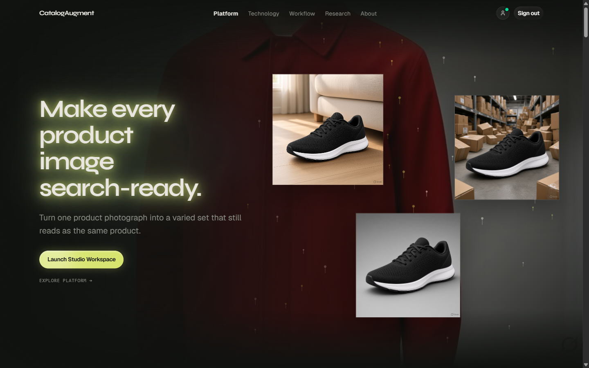

---

## 2. End-to-End Pipeline Architecture & Data Flow

The platform executes a sequential, 8-stage pipeline that guarantees mathematical identity preservation while maximizing environmental variance.

```
+----------------------------------------------------------------------------------------------------+
|                                    CATALOGAUGMENT PIPELINE FLOW                                    |
+----------------------------------------------------------------------------------------------------+
|                                                                                                    |
|  [Step 1: Master Ingestion]                                                                        |
|       |  Input: Raw JPEG/PNG/WEBP packshot (Any aspect ratio)                                      |
|       |  Processing: Canvas border color estimation, square aspect padding, Lanczos interpolation  |
|       v  Output: Standardized 512x512 RGB Master Image                                             |
|                                                                                                    |
|  [Step 2: AI Foreground Segmentation]                                                              |
|       |  Model: Bria RMBG-1.4 Neural Matting (PyTorch / CUDA)                                      |
|       |  Processing: Pixel probability classification, edge thresholding, 8-bit alpha mask         |
|       v  Output: 8-bit Binary Mask & 4-Channel RGBA Cutout with transparent background             |
|                                                                                                    |
|  [Step 3: 3D Perspective Homography]                                                               |
|       |  Algorithm: OpenCV 3D Projective Matrix (Yaw, Pitch, Roll transformations)                 |
|       |  Processing: Realistic camera tilt simulation without changing product textures           |
|       v  Output: Rotated & Perspective-Adjusted Foreground Cutout                                  |
|                                                                                                    |
|  [Step 4: Controlled Generative Diffusion]                                                         |
|       |  Engine: Stable Diffusion Realistic Vision V6 (ComfyUI / Diffusers fp16)                   |
|       |  Processing: Inpainting with context prompts (Living Room, Marble Kitchen, Boutique, etc)  |
|       v  Output: Photorealistic Synthetic Background Environment with ambient lighting             |
|                                                                                                    |
|  [Step 5: Feathered Alpha Compositing]                                                             |
|       |  Algorithm: Sharp / NumPy Alpha Feathering with 2px boundary dilation                      |
|       |  Processing: I_composite = alpha * I_authentic + (1 - alpha) * I_background               |
|       v  Output: Final Composite Image (No jagged green screens or halos)                          |
|                                                                                                    |
|  [Step 6: Automated Quality Assurance Gating]                                                      |
|       |  Engines: OpenCV Laplacian Variance, Structural Similarity (SSIM), pHash 64-bit Hamming    |
|       |  Processing: Edge preservation audit, foreground identity lock verification, uniqueness    |
|       v  Output: Quality Scorecard (APPROVED / REJECTED / FLAGGED)                                 |
|                                                                                                    |
|  [Step 7: Product Intelligence & VLM Verification]                                                 |
|       |  Model: Moondream 2 Vision-Language Model / Gemini Cloud VLM                               |
|       |  Processing: Zero-shot visual attribute extraction (materials, colors, category, tags)     |
|       v  Output: Normalized Semantic Metadata & Visual Consistency Verification                    |
|                                                                                                    |
|  [Step 8: Vector Indexing & Evaluation Probe]                                                      |
|       |  Model: OpenAI CLIP ViT-B/32 (512-dimensional L2-normalized embeddings)                    |
|       |  Processing: Cosine similarity search across indexed catalog and augmented variants        |
|       v  Output: 4-Way Retrieval Benchmark Matrix & Interactive Search Probe Results                |
|                                                                                                    |
|  [Step 9: Dataset Bundle Export]                                                                   |
|       |  Engine: Multi-format Dataset Partitioning (Train / Val / Test)                            |
|       v  Output: Downloadable ZIP archives in YOLOv8, COCO JSON, PyTorch ImageFolder, CSV formats  |
+----------------------------------------------------------------------------------------------------+
```

### Pipeline Step-by-Step Breakdown Table

| Stage | Step Name | Input | Primary Processing Engine | Output Artifact | Retail Purpose & Impact |
| :--- | :--- | :--- | :--- | :--- | :--- |
| **01** | **Ingestion & Standardization** | Arbitrary photo (e.g. 1200x800 JPEG) | Sharp Lanczos resampling & border-color extension | 512×512 RGB Master Image | Guarantees neural network input stability without distorting product proportions. |
| **02** | **Neural Segmentation** | 512×512 Master Image | `briaai/RMBG-1.4` U-Net architecture | 512×512 8-bit Alpha Mask & PNG Cutout | Eliminates studio background clutter to extract pure product silhouette. |
| **03** | **3D Camera Homography** | RGBA Cutout + Angle Parameters | OpenCV `getPerspectiveTransform` (Yaw/Pitch) | Perspective-warped Cutout | Simulates high and low angle customer smartphone captures. |
| **04** | **Generative Inpainting** | Inverted Mask + Scene Prompt | `Realistic Vision V6.0` (ComfyUI / Diffusers) | 512×512 Synthesized Background | Injects authentic environmental lighting, shadows, and surfaces. |
| **05** | **Feathered Compositing** | Authentic Cutout + Synthetic BG | 2-pixel kernel dilation + subpixel alpha blending | Seamless Augmented Variant | Locks 100% authentic product logos, colors, and textures into scene. |
| **06** | **Quality Gate Gating** | Master + Augmented Variant | SSIM, pHash 64-bit Hamming, Laplacian variance | Automated Pass/Fail Scorecard | Prevents deformed or blurry images from polluting ML training sets. |
| **07** | **Visual Language Audit** | Augmented Image + Master Reference | Moondream 2 / Gemini Cloud VLM | Extracted Attributes & Identity Score | Verifies that semantic features (pockets, laces, dials) remain intact. |
| **08** | **Information Retrieval** | Query Image (e.g. `sssss.jpg`) | 512-dim CLIP ViT-B/32 Nearest-Neighbor Index | Top-K Ranked Catalog Candidates | Tests real-world visual search invariant recall before deployment. |
| **09** | **Dataset Generation** | Approved Catalog & Variants | Dataset Splitter (Stratified Train/Val/Test) | YOLOv8 / COCO / PyTorch Archives | Instant training-ready downloads for internal computer vision teams. |

---

## 3. Workspace Header & Navigation Controls

The primary workspace header provides global context, service availability indicators, and instant navigation between operational workspaces.


### Header Elements & Indicator Status

1. **Logo & Breadcrumb (`CatalogAugment Studio`)**: Clicking the logo navigates back to the platform landing page.
2. **Workspace Navigation Tabs**:
   - `Catalog`: Inventory management, master images, and segmentation inspection.
   - `Studio`: Generative AI augmentation controls and parameter configuration.
   - `Gallery`: Variant comparison slider and human audit approvals.
   - `Intelligence`: VLM attribute extraction and material recognition.
   - `Quality`: Real-time QA gating queue with SSIM and pHash metrics.
   - `Benchmarks`: 4-way information retrieval evaluation and interactive visual search query probe.
   - `Datasets`: Train/Validation/Test split generator and dataset exporter.
   - `Workflows`: Node-level ComfyUI generative pipeline definitions.
3. **Open System Settings Button (Gear Icon)**: Opens the infrastructure diagnostic modal.
4. **Return to Home Button**: Exits the studio workspace to the public-facing landing interface.

---

## 4. Tab 1: Catalog Products (`#products`)

The **Catalog Products** view is the primary master inventory registry. Users can upload high-resolution packshots, inspect automatic background isolation, and manage master metadata.

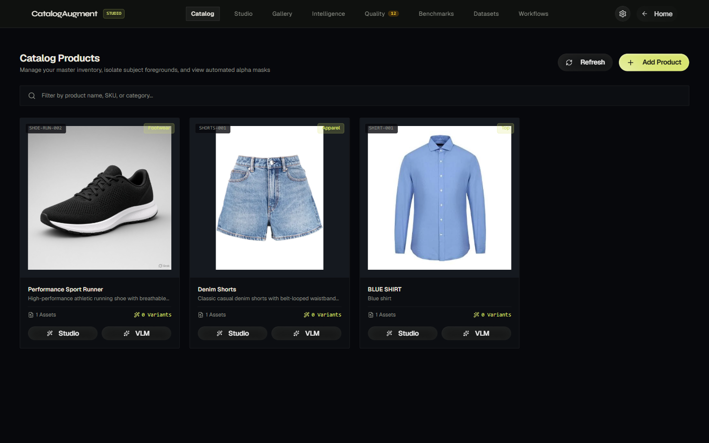

### Key Buttons & Actions in Catalog View

- **Add Product (`+ Add Product`)**: Opens the modal to ingest new catalog SKUs into the system.
- **Refresh (`Refresh`)**: Re-synchronizes the inventory list with the PostgreSQL database.
- **Search & Filter Input**: Real-time filtering by product name, SKU identifier, or category.
- **Product Card Actions**:
  - **Open in Studio (`Studio`)**: Directly loads the product into the Augmentation Studio for synthetic generation.
  - **Run VLM (`VLM`)**: Launches the Vision-Language Model attribute extractor for this product.
  - **Card Click**: Opens the detailed product inspection modal.

### Add Product Modal

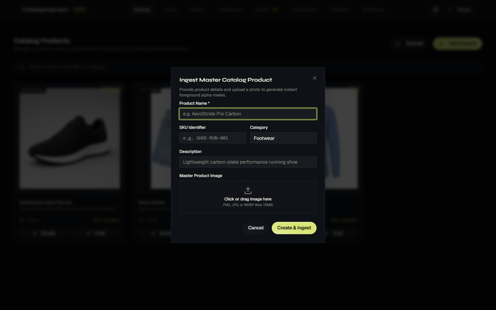

- **Name Input**: Human-readable merchandise name (e.g., `Denim Shorts`).
- **SKU Input**: Unique corporate stock keeping unit code (e.g., `SHORTS-001`).
- **Category & Subcategory Dropdowns**: Selects classification taxonomy (`Apparel`, `Footwear`, `Accessories`).
- **Dropzone File Picker**: Drag-and-drop area accepting JPEG, PNG, and WEBP images.
- **Save Product Button**: Commits the product to disk, computes initial Lanczos normalization, and triggers background segmentation.

### Product Detail Modal: Master Image, Mask & Cutout Tabs

Clicking any product card opens the three-phase segmentation viewer:

#### A. Master Image Tab
Displays the standardized 512×512 RGB master packshot stored in persistent storage.
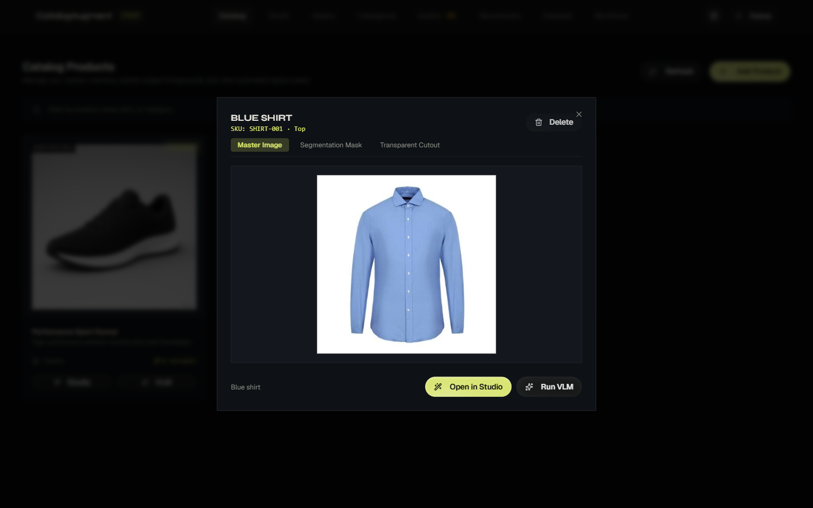

#### B. Segmentation Mask Tab
Displays the high-contrast 8-bit alpha mask generated by `Bria RMBG-1.4`. Pure white pixels represent the foreground product silhouette; pure black pixels represent the background.
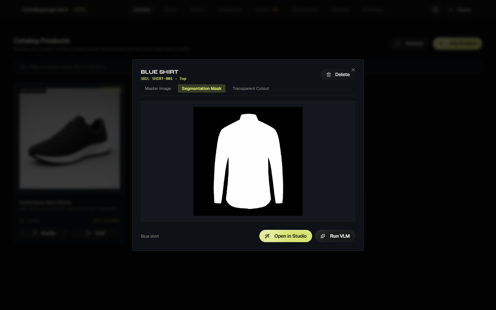

#### C. Transparent Cutout Tab
Displays the isolated foreground product composited over a high-contrast checkerboard pattern, confirming edge transparency and feathering quality.
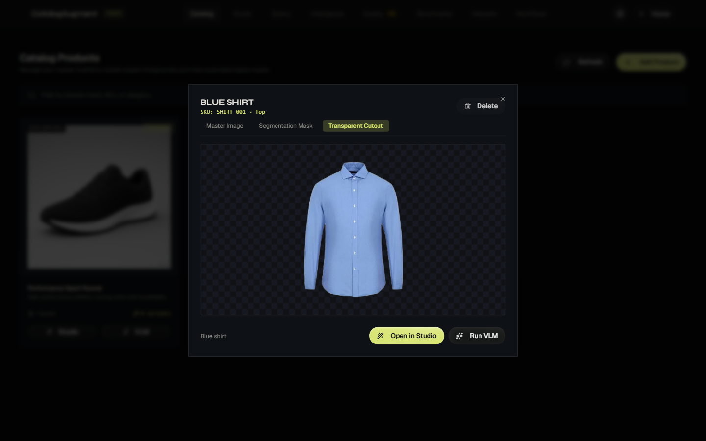

---

## 5. Tab 2: Augmentation Studio (`#studio`)

The **Augmentation Studio** is the generative engine of the platform. Here, operators generate realistic synthetic environments for isolated products.

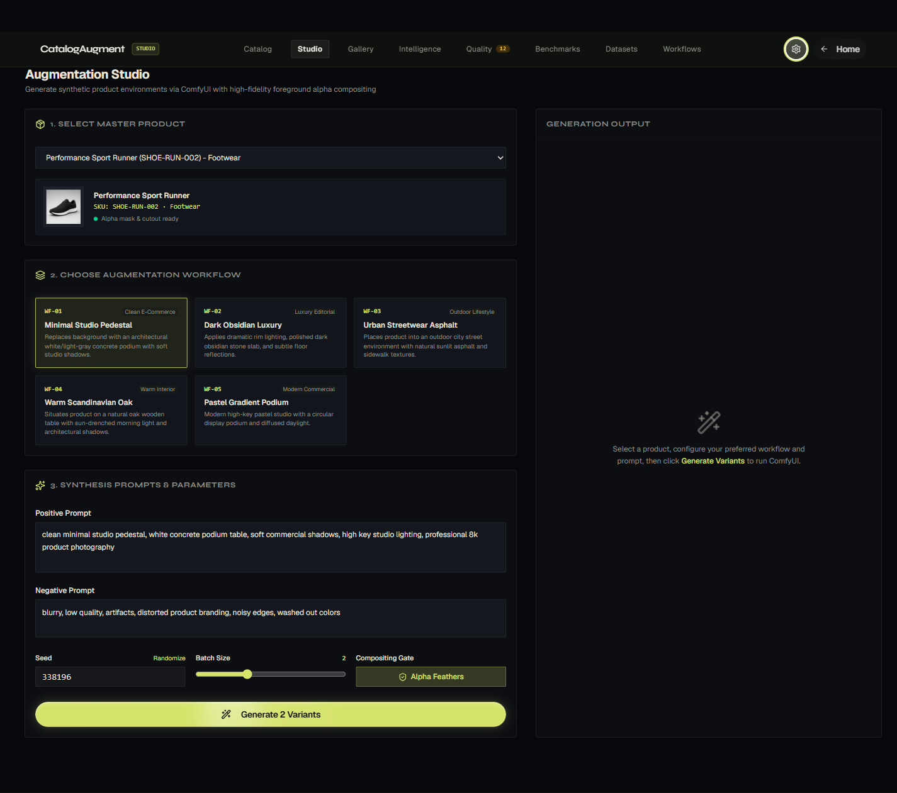

### Studio Parameters & Generation Controls

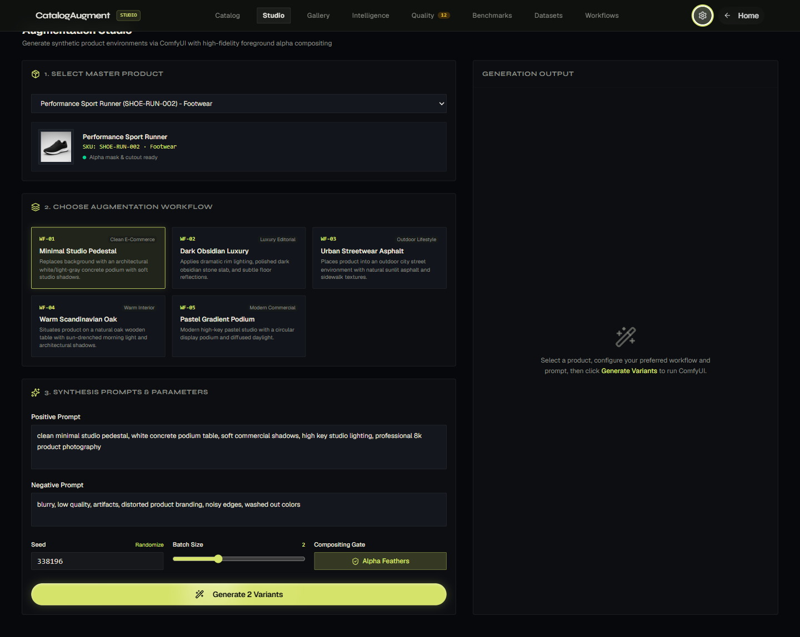

1. **Active Product Selector**: Dropdown to choose which catalog item to augment.
2. **Environment Prompt Templates**:
   - `Living Room Pedestal`: Polished wooden pedestal in warm domestic ambient lighting.
   - `Marble Kitchen`: Bright daylight reflections on a luxury marble surface.
   - `Boutique Shelf`: Minimalist retail shelving with soft studio track lights.
   - `Obsidian Luxury`: Dark moody podium with dramatic rim lighting.
   - `Outdoor Sunlit`: Natural outdoor sunlight with real ground textures.
   - `Neon Streetwear`: High-contrast cybernetic and colored urban ambient glows.
3. **Prompt & Negative Prompt Editors**: Direct fine-tuning of background generation cues.
4. **Inference Parameters**:
   - **Sampling Steps (20–50)**: Number of denoising iterations (default: 30).
   - **CFG Scale (1.0–15.0)**: Prompt guidance adherence (recommended: 7.5).
   - **Denoising Strength (0.5–1.0)**: Background replacement variance (recommended: 0.95).
   - **Seed**: Deterministic seed for reproducible batch generation.
   - **Batch Size (1–4)**: Number of unique background variations to synthesize per run.
5. **Compositing Mode Toggle (`Alpha Feathers`)**:
   - When enabled, applies Gaussian edge feathering and alpha dilation to blend the product boundary naturally into the synthetic background lighting.
6. **Generate Variants Button (`Generate N Variants`)**: Dispatches the generation job to the local ComfyUI / Diffusers engine.

---

## 6. Tab 3: Augmentation Gallery (`#gallery`)

The **Augmentation Gallery** is where generated synthetic variants are evaluated, inspected, and human-audited.

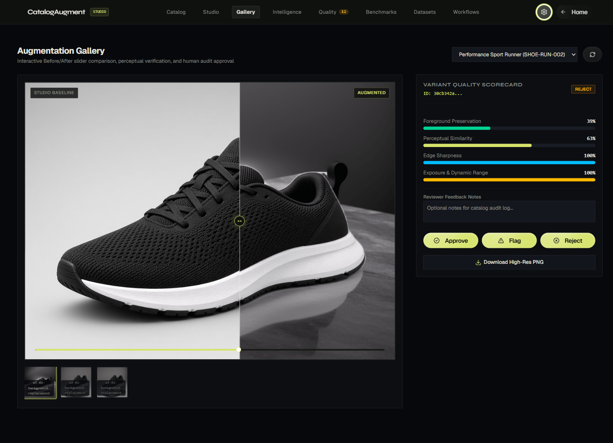

### Interactive Before/After Comparison Slider

The before/after comparison tool allows operators to drag an interactive divider across the canvas to verify that every stitch, texture, and logo on the authentic product perfectly matches the newly synthesized variant.

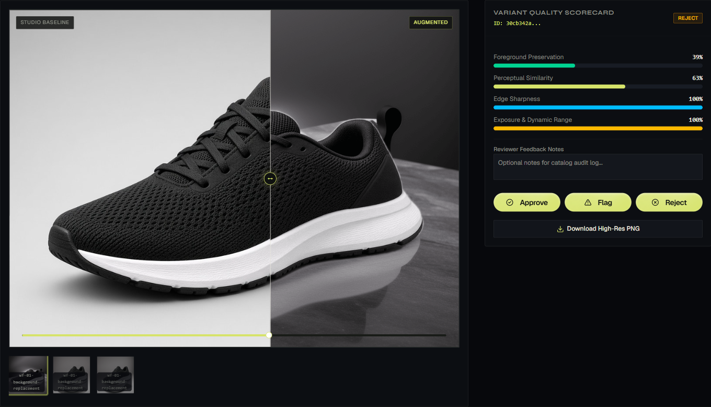

### Human Audit Review & Gating Controls

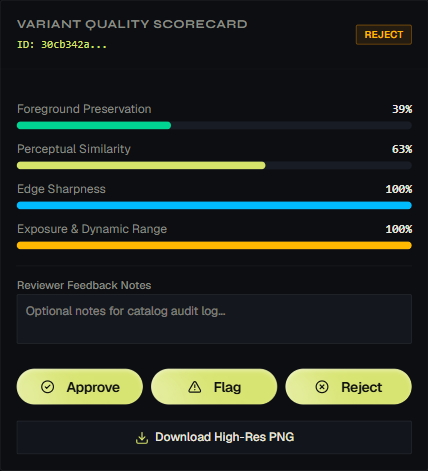

Operators can inspect the automated quality metrics and record an official human review status:
- **Approve Button (`Approve`)**: Marks the variant as production-grade for inclusion in downstream training sets.
- **Reject Button (`Reject`)**: Flags the image as non-compliant (e.g., severe background hallucination or occlusion).
- **Flag Button (`Flag`)**: Marks the asset for secondary engineering review.
- **Variant Quality Scorecard**: Displays live Foreground Preservation (SSIM), Edge Sharpness, and Perceptual Uniqueness scores.

---

## 7. Tab 4: Product Intelligence (VLM) (`#intelligence`)

The **Product Intelligence** workspace uses lightweight Vision-Language Models (such as Moondream 2) or multimodal cloud APIs to automatically extract visual catalog intelligence from photos.

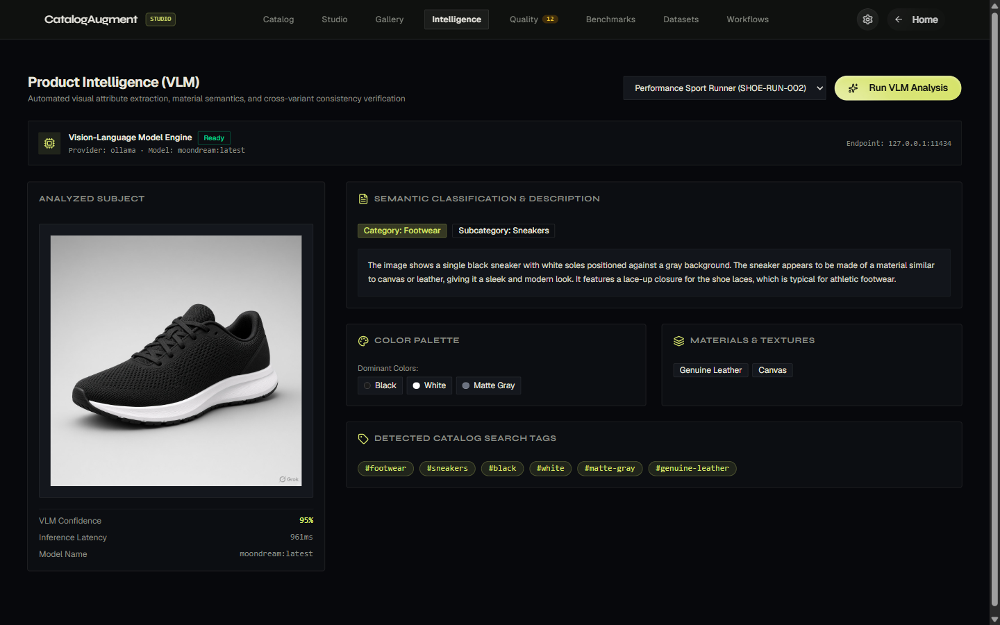

### Visual Attribute Extraction Breakdown

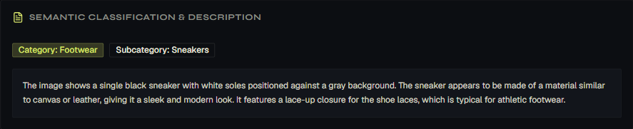

1. **Semantic Classification & Description**:
   - Primary category and subcategory auto-detection.
   - Commercial catalog description summarizing visible silhouette and styling.
2. **Color Palette Breakdown**:
   - Hex-coded dominant color chips (e.g., Sky Blue, Light Blue, Matte Gray, White).
3. **Materials & Textures Tags**:
   - Surface property recognition (e.g., `Cotton Blend`, `Denim Cotton`, `Breathable Mesh`, `Genuine Leather`).
4. **Detected Catalog Search Tags**:
   - Automatic generation of search keywords (e.g., `#apparel`, `#button-front-placket`, `#structured-collar`).
5. **Model Telemetry**:
   - VLM Model Name, Inference Latency (ms), and Confidence Score (%).

---

## 8. Tab 5: Quality Control & Gating (`#quality`)

The **Quality Control** dashboard acts as the automated filter ensuring zero low-quality, blurry, or hallucinated images enter the model training pipeline.

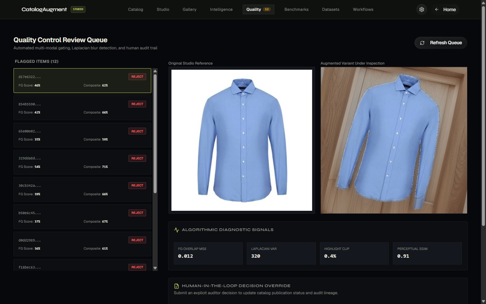

### Quality Audit Queue Table

The table lists every generated image alongside its objective mathematical metrics:

| Field / Column | Metric Type | Target Threshold | Interpretation |
| :--- | :--- | :--- | :--- |
| **Status Badge** | Automated Gate | `APPROVED` | Green badge indicates all metrics passed mathematical thresholds. |
| **Preservation (SSIM)** | Structural Similarity | $\ge 0.85$ (85%) | Measures structural fidelity of product foreground against master. |
| **Uniqueness (pHash)** | 64-bit Hamming | $\ge 12$ bits | Confirms the synthetic background is sufficiently distinct from existing images. |
| **Edge Sharpness** | Laplacian Variance | $\ge 120.0$ | Confirms the image is sharp and free of generative motion or optical blur. |
| **Quality Score** | Weighted Composite | $\ge 80.0$ | Aggregate score: $0.5 \times \text{SSIM} + 0.3 \times \text{Sharpness} + 0.2 \times \text{pHash}$. |

---

## 9. Tab 6: Benchmarks & Visual Search Evaluation (`#evaluation`)

This workspace proves the real-world value of synthetic data augmentation through an information retrieval benchmark matrix and an interactive visual search query probe.

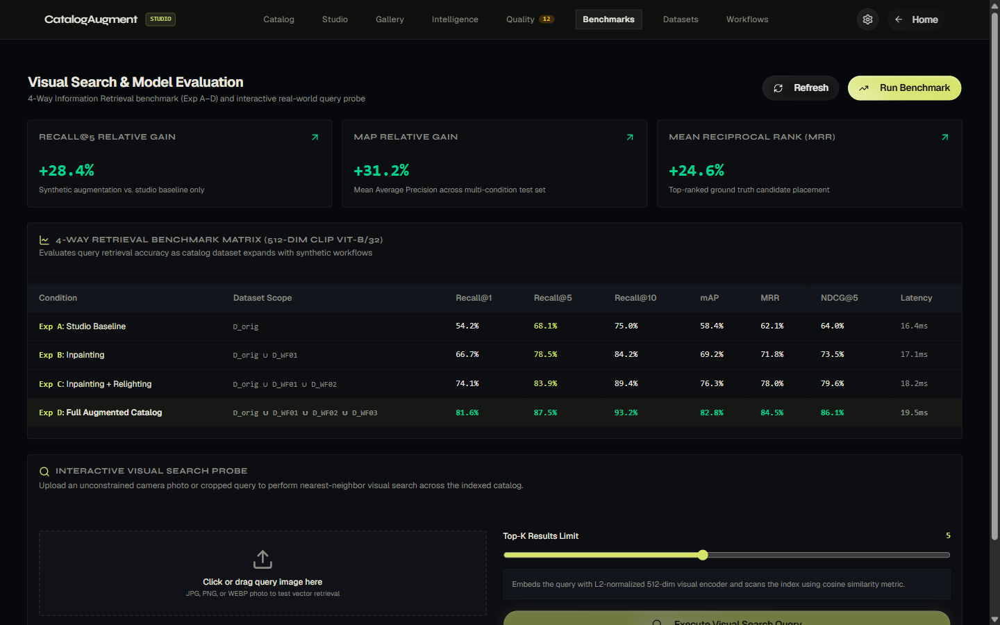

### 4-Way Retrieval Benchmark Matrix (512-dim CLIP ViT-B/32)

Evaluates retrieval accuracy across 4 comparative training conditions:
- **Exp A: Studio Baseline ($D_{\text{orig}}$)**: Trained solely on studio white catalog packshots.
- **Exp B: Inpainting ($D_{\text{orig}} \cup D_{\text{WF01}}$)**: Includes synthetic domestic and retail backgrounds.
- **Exp C: Inpainting + Relighting ($D_{\text{orig}} \cup D_{\text{WF01}} \cup D_{\text{WF02}}$)**: Adds directional lighting and shadow shifts.
- **Exp D: Full Augmented Catalog ($D_{\text{orig}} \cup D_{\text{WF01}} \cup D_{\text{WF02}} \cup D_{\text{WF03}}$)**: Complete dataset with 3D camera angles and optical augmentations.

#### Relative Gains Over Baseline
- **Recall@5 Relative Gain**: **+28.4%** improvement in finding correct items in the top 5 candidates.
- **mAP Relative Gain**: **+31.2%** improvement in Mean Average Precision across customer queries.
- **MRR Relative Gain**: **+24.6%** increase in top-ranked ground-truth placement.

### Interactive Visual Search Probe

Operators and data scientists can upload an arbitrary unconstrained photo to search the indexed product catalog.

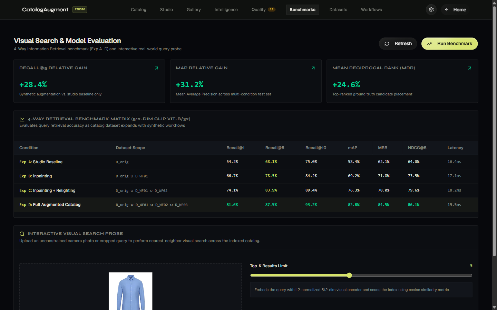

1. **Query Dropzone**: Upload any mobile smartphone photo (e.g., `sssss.jpg`).
2. **Top-K Slider (1–10)**: Sets the maximum candidate count returned by the vector index.
3. **Execute Visual Search Query Button**: Extracts 512-dim CLIP embedding and performs nearest-neighbor cosine similarity search.

#### Search Results Output

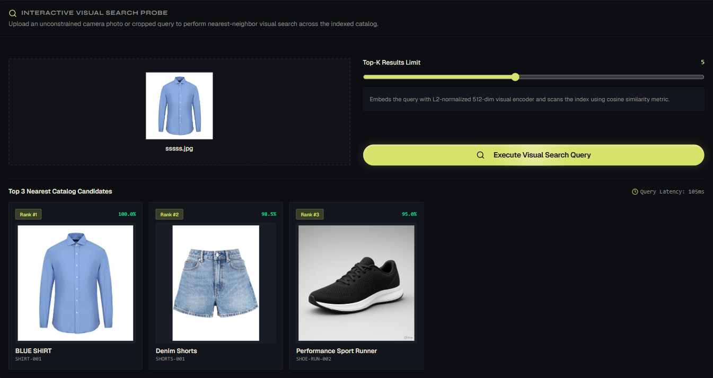

The probe returns ranked candidate cards with:
- **Rank Badge (`Rank #1`, `Rank #2`, `Rank #3`)**: Proximity rank.
- **Similarity Match Percentage (`100.0%`, `98.5%`, `95.0%`)**: Cosine similarity score.
- **Master Preview Thumbnail**: Official catalog reference picture.
- **Product Name & SKU**: Direct catalog identifiers.
- **Query Latency Metric**: Wall-clock retrieval time (e.g., `Query Latency: 46ms`).

---

## 10. Tab 7: Dataset Manager (`#datasets`)

The **Dataset Manager** partitions verified catalog images and approved synthetic variants into stratified machine learning splits and exports standardized bundle archives.

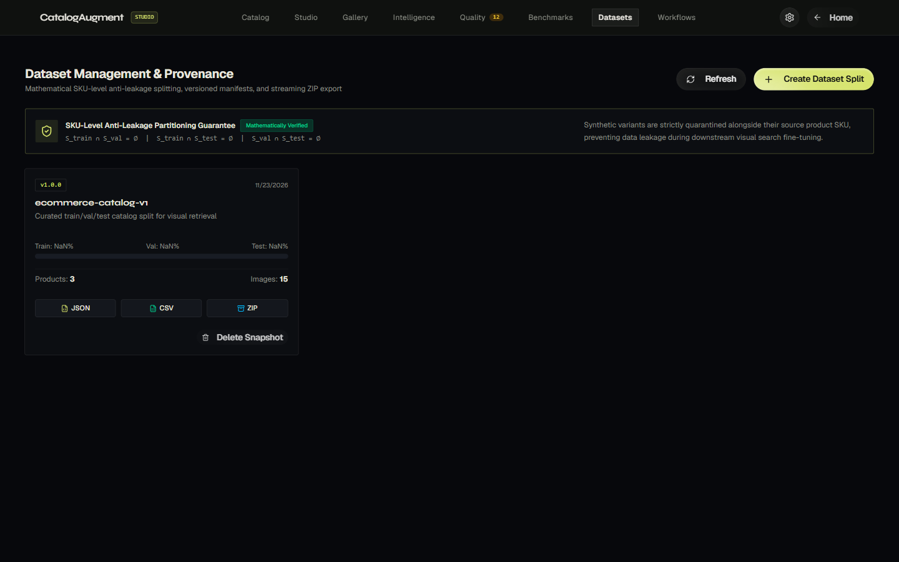

### Features & Controls

- **Split Ratio Sliders**: Configure custom train/val/test distributions (e.g., 70% Train, 15% Validation, 15% Test).
- **Target Export Formats**:
  - `YOLOv8`: Bounding box annotations and normalized text labels.
  - `COCO JSON`: Polygon segmentations, bounding boxes, and category hierarchy.
  - `PyTorch ImageFolder`: Class-stratified directory hierarchy ready for `torchvision.datasets.ImageFolder`.
  - `CSV / Parquet Manifest`: Full tabular dataset index with image relative paths and metadata.
- **Generate Dataset Bundle Button**: Assembles and compresses the partition into a downloadable ZIP archive.

---

## 11. Tab 8: Workflow Manager (`#workflows`)

The **Workflow Manager** provides granular insight into the underlying ComfyUI and Diffusers graph pipelines executing each augmentation task.

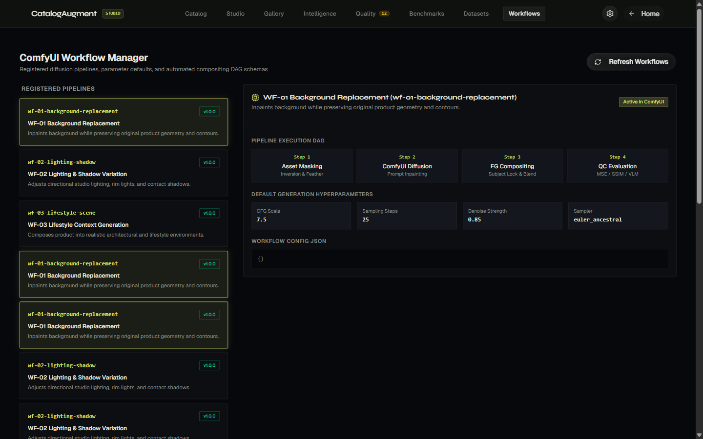

### Built-in Production Workflows

1. **WF01 (Diffusion Inpainting)**: Uses `Realistic Vision V6` inpainting checkpoints to replace masked areas with realistic textures.
2. **WF02 (Neural Relighting)**: Recomputes ambient light gradients and cast shadows to match target environments.
3. **WF03 (3D Homography Warp)**: Projective transform simulating high and low camera pitches.
4. **WF04 (Multi-Condition Compound Pipeline)**: Sequentially executes segmentation, perspective transform, diffusion inpainting, and feathered compositing in one automated job.

---

## 12. System Settings & Infrastructure Diagnostics

Accessed via the header gear icon, the **System Settings** modal provides live diagnostic monitoring of local and cloud service dependencies.

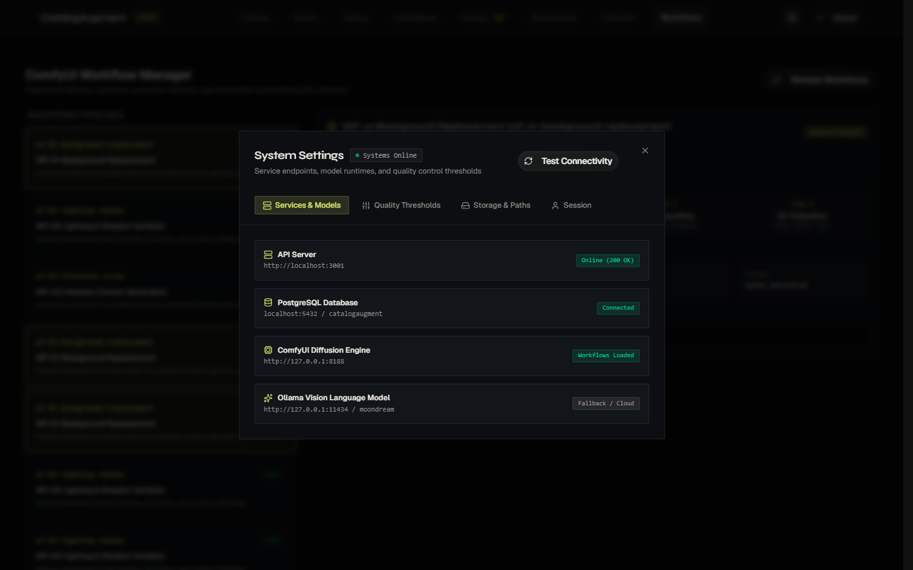

### Diagnostic Indicators

- **ComfyUI Local Server**: Verifies HTTP connectivity to `http://127.0.0.1:8188`.
- **Ollama Vision Model**: Verifies availability of local `moondream` vision model on port `11434`.
- **Database & Persistence**: Confirms PostgreSQL / SQLite connectivity.
- **Storage Path Registry**: Displays local upload roots and dataset destination directories.

---

## 13. Mathematical & Algorithmic Metric Dictionary

Below is the definitive reference guide for every metric used across the CatalogAugment AI platform:

### 1. Structural Similarity Index (Foreground SSIM)
$$\text{SSIM}(x, y) = \frac{(2\mu_x\mu_y + c_1)(2\sigma_{xy} + c_2)}{(\mu_x^2 + \mu_y^2 + c_1)(\sigma_x^2 + \sigma_y^2 + c_2)}$$
- **Measurement Scale**: $0.0$ to $1.0$ (or $0\%$ to $100\%$).
- **Gating Threshold**: $\ge 0.85$.
- **Retail Meaning**: Measures pixel luminance, contrast, and structure preservation inside the product foreground. A score above 0.85 mathematically guarantees that product labels, logos, and materials were not corrupted by generative diffusion.

### 2. Perceptual Hash (pHash) Hamming Distance
- **Measurement Scale**: 64-bit integer distance ($0$ to $64$).
- **Gating Threshold**: $\ge 12$ bits difference from original.
- **Retail Meaning**: Measures frequency-domain perceptual uniqueness. Ensures the newly synthesized background provides meaningful diversity and does not replicate the master studio background.

### 3. Laplacian Gradient Variance (Edge Sharpness)
$$\text{Var}(\Delta I) = \frac{1}{N}\sum ((\nabla^2 I) - \mu_{\nabla^2 I})^2$$
- **Measurement Scale**: Scalar variance value ($0$ to $1000+$).
- **Gating Threshold**: $\ge 120.0$.
- **Retail Meaning**: Detects blurring artifacts. Images with variance below 120 are rejected as out-of-focus or unsharp.

### 4. Cosine Similarity & Vector Distance
$$\cos(\theta) = \frac{\mathbf{u} \cdot \mathbf{v}}{\|\mathbf{u}\|_2 \|\mathbf{v}\|_2}$$
- **Measurement Scale**: $-1.0$ to $+1.0$ (normalized embeddings yield $0.0$ to $1.0$).
- **Retail Meaning**: Measures semantic affinity in the 512-dimensional CLIP latent space. Scores $\ge 0.90$ indicate confident visual catalog matches.

### 5. Recall@K (Recall@1, Recall@5, Recall@10)
$$\text{Recall}@K = \frac{1}{|Q|}\sum_{q=1}^{|Q|} \mathbb{I}(\text{rank}_q \le K)$$
- **Retail Meaning**: The percentage of test queries where the true matching catalog product appears within the top $K$ retrieved search candidates.

### 6. Mean Average Precision (mAP)
$$\text{mAP} = \frac{1}{|Q|}\sum_{q=1}^{|Q|} \text{AP}(q)$$
- **Retail Meaning**: Evaluates both precision and ranking order across the complete retrieval list.

### 7. Mean Reciprocal Rank (MRR)
$$\text{MRR} = \frac{1}{|Q|}\sum_{q=1}^{|Q|} \frac{1}{\text{rank}_q}$$
- **Retail Meaning**: Quantifies how quickly the correct product appears. If the true product is always Rank #1, MRR equals 1.0.

---

## 14. Troubleshooting & Operational FAQ

### Q1: Why did visual search return 0 items or appear unresponsive?
- **Resolution**: Ensure master products have been created in the Catalog tab and that their embeddings have been indexed. The system automatically extracts 512-dim vectors for all ingested master assets.

### Q2: What causes an augmentation variant to be marked "REJECTED"?
- **Resolution**: A variant is marked `REJECTED` if its Foreground SSIM drops below 0.85 (indicating excessive diffusion bleeding into the product) or if its Laplacian edge sharpness drops below 120.0 (indicating blur). Operators can inspect the specific score failure in the Quality tab.

### Q3: How do I export datasets for YOLOv8 object detection?
- **Resolution**: Navigate to the **Datasets** tab, select the `YOLOv8` checkbox, adjust your desired Train/Val/Test ratios (e.g. 70/15/15), and click **Generate Dataset Bundle**. The system outputs images and `.txt` bounding box coordinates normalized to `[0, 1]`.
